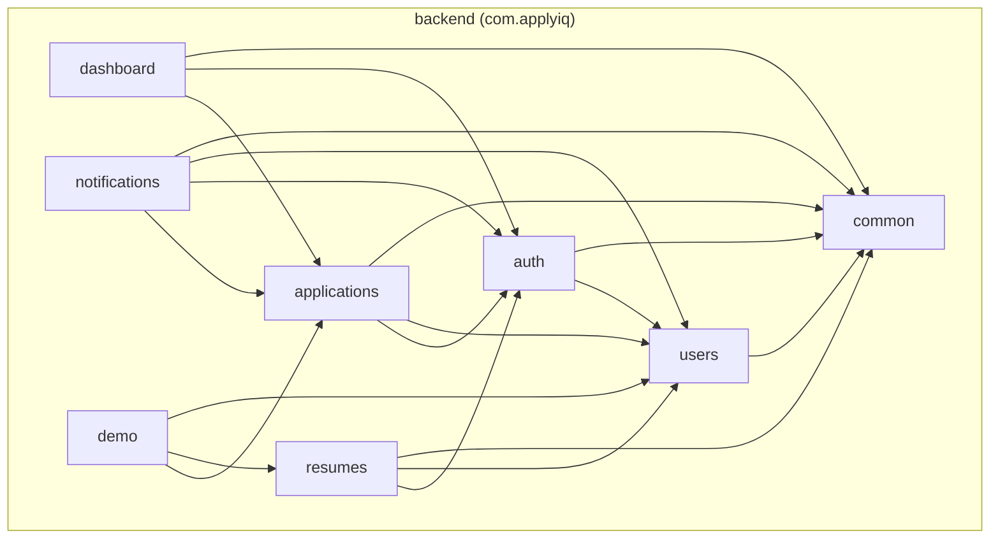

# Graphify

Turns this repo's actual directory/import structure into a Mermaid
dependency graph — not a hand-drawn guess, but edges extracted from real
`import` statements, so the diagram stays honest as the codebase changes.

## What it covers

Three scopes, pick based on what the user asked for (default to "whole repo"
if unspecified):

- **Whole repo** — a high-level box diagram: Frontend, Backend, Database,
  plus how they relate (frontend not yet wired to backend — see below).
- **Backend** — the package-dependency graph among
  `backend/src/main/java/com/applyiq/*` domain packages (`auth`, `users`,
  `applications`, `resumes`, `dashboard`, `notifications`, `demo`, `common`).
- **Frontend** — the module-dependency graph among `frontend/src/*`
  top-level directories (`pages`, `components/ui`, `components/app`,
  `components/layout`, `components/sections`, `lib`, `context`, `data`,
  `types`).

## How to build it

1. **Extract real edges with the helper scripts** — don't hand-derive the
   graph by reading files yourself, the scripts already parse every import:

   ```bash
   bash .claude/skills/graphify/scripts/extract_backend_deps.sh
   bash .claude/skills/graphify/scripts/extract_frontend_deps.sh
   ```

   Each prints deduped `source -> target` edges, one per line, based on
   `import com.applyiq.*` statements (backend) and `@/...` path-alias
   imports (frontend — see `frontend/tsconfig.app.json` for the alias).
   Both are read-only and safe to run anytime; re-run them any time the
   graph might be stale (they always reflect the current tree).

   If asked to graph a *different* repo/module layout (not backend Java
   packages or `@/`-aliased frontend), the scripts won't apply — read
   imports directly instead, same edge format (`source -> target`).

2. **Turn the edge list into a Mermaid `graph TD`.** Group nodes into
   `subgraph` blocks that match the scope:
   - Backend: one subgraph per domain package, or a single subgraph
     `Backend` if graphing the whole repo at low detail.
   - Frontend: subgraph per top-level module; nest `components/*` under a
     `Components` subgraph for readability.
   - Whole repo: subgraphs `Frontend`, `Backend`, `Database`, with a
     dashed edge `Frontend -.-> Backend` labeled "not wired up yet — mock
     data only" (true as of this writing — check
     `frontend/src/lib/api-client.ts` usage in `pages/*` if verifying this
     is still accurate) and a solid edge `Backend --> Database` labeled
     "JPA/Hibernate".
   - Keep edges deduped and drop obvious noise (e.g. every module
     importing `types` or `lib/utils` is expected and not interesting at
     whole-repo scope — collapse or omit those if the graph gets busy).

3. **Deliver it.** For a quick answer, put the Mermaid code block directly
   in the chat response — it renders inline. If the user wants something
   shareable/persistent, or asked for a diagram/visualization explicitly,
   publish it as an Artifact instead (load the `artifact-diagramming` skill
   first for Mermaid-in-Artifact conventions) rather than only printing it.

## Example

Backend edges from the extractor:

```
applications -> auth
applications -> common
applications -> users
auth -> common
auth -> users
dashboard -> applications
dashboard -> auth
dashboard -> common
notifications -> applications
notifications -> auth
notifications -> common
notifications -> users
resumes -> auth
resumes -> common
resumes -> users
users -> common
```

Becomes:



(`common` fans in from everywhere — expected for a shared-utilities
package; call that out in prose rather than cluttering the diagram with
every edge into it, if the graph is getting dense.)

## Keeping it accurate

This skill has no cache — every run re-derives the graph from the current
tree, so there's nothing to invalidate. If the repo's structure changes
significantly (new top-level frontend directories, a new backend domain
package, the path alias in `tsconfig.app.json` changes), the scripts keep
working as-is since they walk the directory tree at run time; only update
them if the *conventions* change (e.g. imports stop using the `@/` alias).
